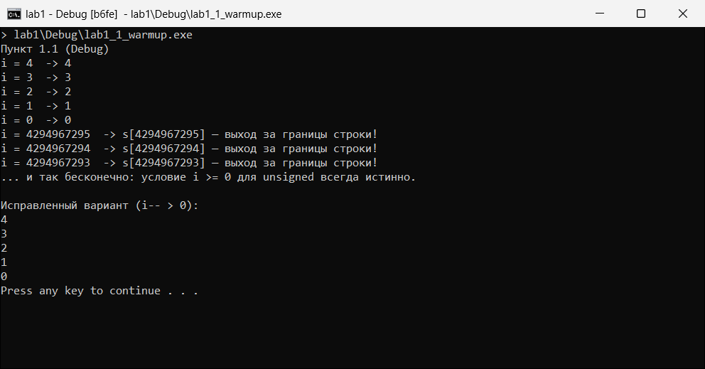
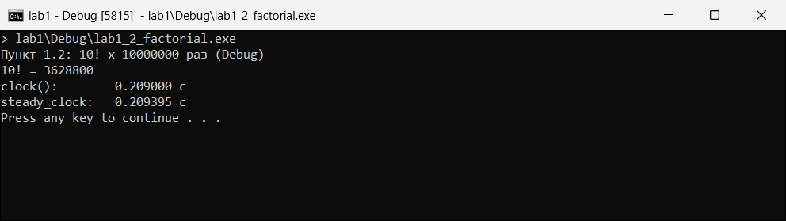
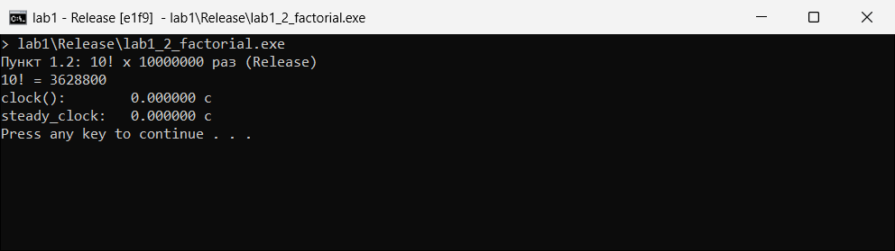
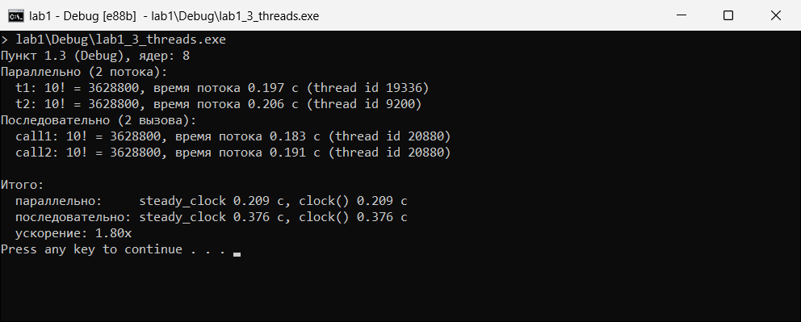
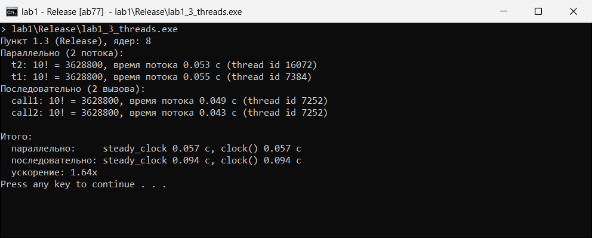

# Лабораторная №1. Утренняя зарядка

**Студент:** Пряников Максим Андреевич

**ОС:** Windows 11 Pro (сборка 26200), 8 логических ядер

**IDE:** Visual Studio Community 2026 (версия 18.12), компилятор MSVC 19.52, CMake 4.3, сборка x64

Проект — CMake, три программы: `lab1_1_warmup` (warmup.cpp), `lab1_2_factorial` (factorial.cpp), `lab1_3_threads` (threads.cpp).

## Пункт 1.1. Разминка

```cpp
string s = "01234";
for(unsigned int i = s.size() - 1; i >= 0; i-- )
{
   std::cout<<s[i]<<std::endl;
}
```

**Что выведет программа и почему?**

Сначала программа выведет символы строки в обратном порядке, каждый с новой строки: `4 3 2 1 0`. На этом цикл не остановится. Счётчик `i` беззнаковый, поэтому условие `i >= 0` истинно всегда. Когда `i` равен 0, декремент `i--` не даёт −1, а переполняется по модулю 2^32, и `i` становится 4294967295. Дальше программа обращается к `s[4294967295]`, то есть читает память далеко за пределами строки. Это неопределённое поведение:

- в Debug-сборке MSVC срабатывает проверка в `std::string::operator[]` — программа останавливается с сообщением «string subscript out of range»;
- в Release проверок нет, программа читает чужую память: печатает мусор либо падает с ошибкой доступа (access violation), когда попадает на невыделенную страницу.

То есть цикл формально бесконечный, а на практике программа аварийно завершается сразу после вывода `4 3 2 1 0`.

Чтобы безопасно показать это на скриншоте, в `warmup.cpp` в тот же цикл добавлен вывод значения `i`, а само обращение `s[i]` за границей строки заменено сообщением (после трёх таких итераций цикл прерывается). Исходный код без изменений можно запустить так: `lab1_1_warmup.exe raw`. Оба случая проверены этим запуском. В Debug после `4 3 2 1 0` появляется окно «Debug Assertion Failed!» с текстом `Expression: string subscript out of range`. В Release программа печатает `4 3 2 1 0` и сразу аварийно завершается с ошибкой доступа к памяти.

Исправление — не давать беззнаковому счётчику уходить ниже нуля, например `for (size_t i = s.size(); i-- > 0; )`, или использовать знаковый `int i`.



## Пункт 1.2. Упражнение 1

10! вычисляется 10 000 000 раз, время замеряется через `clock()` и дополнительно через `std::chrono::steady_clock`.

Результаты:

- Debug: 0.209 с
- Release: 0.000000 с (меньше разрешения таймера)





**Объяснение.** В Debug оптимизация выключена (`/Od`): каждый вызов `factorial` — настоящий вызов функции, все переменные лежат в памяти (на стеке), добавлены отладочные проверки. Процессор честно выполняет 10 млн вызовов по 9 умножений.

В Release (`/O2`) компилятор видит, что аргумент — константа 10, функция не имеет побочных эффектов, а результат каждый раз один и тот же. Он подставляет функцию в место вызова, вычисляет 10! = 3628800 на этапе компиляции и выбрасывает цикл целиком — в программе остаётся только готовое число. Поэтому время равно нулю: вычислений во время выполнения просто нет. Это не «ускорение в бесконечность», а то, что измеряемая работа была удалена оптимизатором. Чтобы в Release измерить реальные вычисления, нужно помешать этой оптимизации — так сделано в пункте 1.3 (`volatile`).

## Пункт 1.3. Упражнение 2

`Func(string name)` 10 млн раз считает 10!. Сначала она запускается в двух потоках (`std::thread`), затем дважды подряд в главном потоке. Замеряется время обоих вариантов.

Аргумент факториала внутри `Func` объявлен как `volatile int n = 10` — иначе в Release цикл был бы выброшен, как в пункте 1.2, и сравнивать было бы нечего.

Результаты:

- Debug: параллельно 0.209 с, последовательно 0.376 с — ускорение 1.80x
- Release: параллельно 0.057 с, последовательно 0.094 с — ускорение 1.64x





**Выводы.**

- Два потока выполняются на разных ядрах одновременно, поэтому общее время почти равно времени одного вызова, а не сумме двух. Каждый поток по отдельности работает столько же, сколько один последовательный вызов (0.197–0.206 с против 0.183–0.191 с в Debug).
- Ускорение меньше идеальных 2x: часть времени уходит на создание и завершение потоков и на их планирование. Чем короче сама работа, тем заметнее эти накладные расходы — поэтому в Release (работа ~0.05 с) ускорение ниже, чем в Debug.
- В выводе видно, что `t1` и `t2` имеют разные thread id, а `call1` и `call2` — один и тот же (главный поток). Порядок строк `t1`/`t2` между запусками меняется: какой поток закончит первым, решает планировщик ОС.
- `clock()` в MSVC возвращает не процессорное время процесса, а прошедшее реальное время, поэтому его значения совпадают со `steady_clock`. В Linux `clock()` считает суммарное процессорное время всех потоков, и для параллельного варианта он показал бы примерно столько же, сколько для последовательного.
