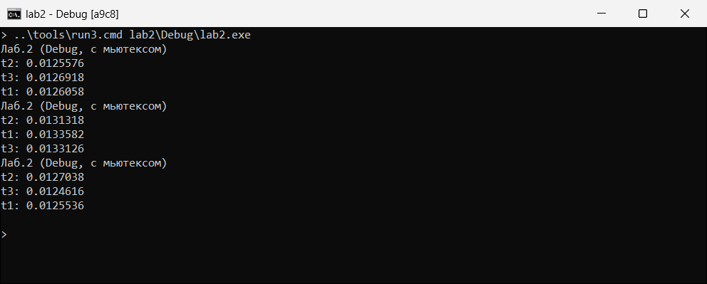
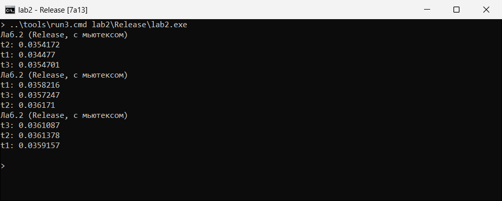
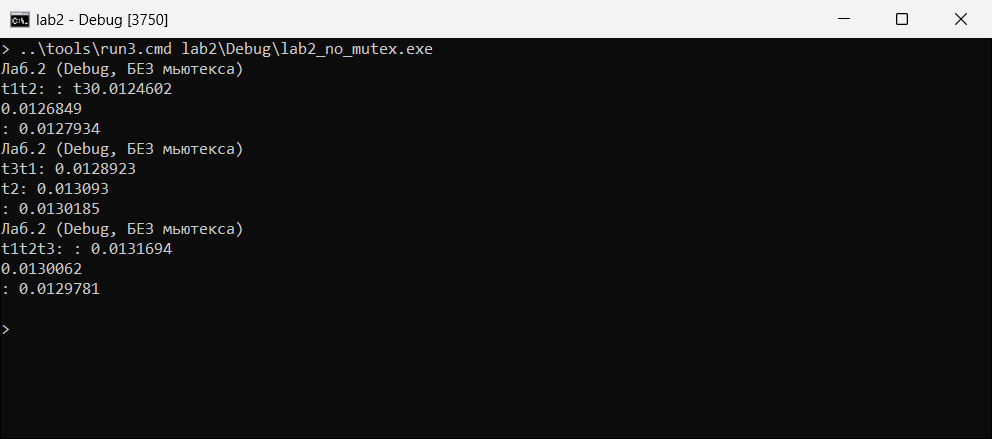
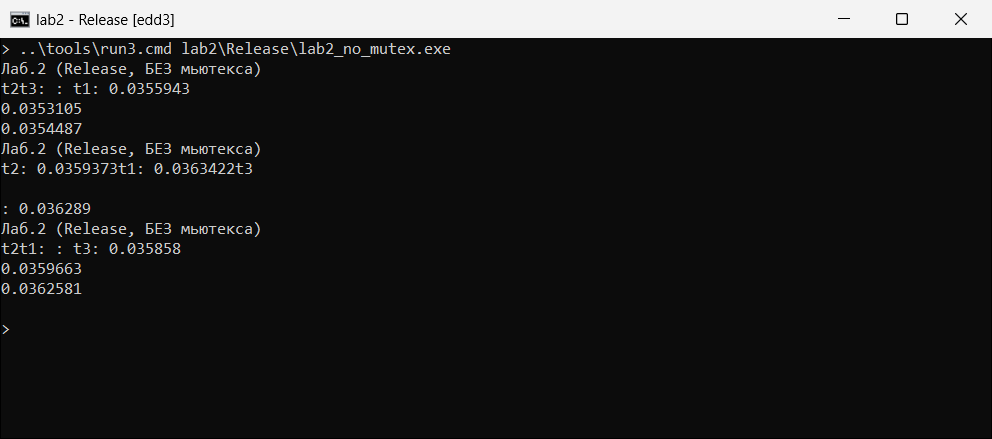

# Лабораторная №2. What's going on?

**Студент:** Пряников Максим Андреевич

**ОС:** Windows 11 Pro (сборка 26200), 8 логических ядер

**IDE:** Visual Studio Community 2026, компилятор MSVC 19.52, CMake 4.3 (генератор «Visual Studio 18 2026», x64)

## Что сделано

Три потока выполняют `Func(name)`. Внутри объявлено `long double i = 0`, и в течение одной секунды к нему на каждой итерации прибавляется 10^-9. В конце поток печатает своё имя и число под глобальным мьютексом `m`.

Из одного `main.cpp` собираются две программы:

- `lab2` — с мьютексом;
- `lab2_no_mutex` — тот же код с определением `NO_MUTEX`, переменная `m` удалена.

Каждая программа запускалась по три раза подряд (скрипт `tools/run3.cmd`).

## Результаты с мьютексом

Debug: значения около 0.0125–0.0134.

Release: значения около 0.0345–0.0362.

## Ответы на вопросы

**Как эти значения отличаются между одинаковыми запусками?**

Значения никогда не повторяются: отличаются и у трёх потоков в одном запуске, и между запусками одной и той же программы. Разброс — несколько процентов (в Debug от 0.01246 до 0.01336, в Release от 0.03448 до 0.03617). Порядок строк `t1`, `t2`, `t3` тоже каждый раз разный. Между конфигурациями разница почти в 3 раза: в Release поток успевает сделать около 36 млн итераций за секунду, в Debug — около 13 млн.

**Как ведётся учёт времени? Как он влияет на результат?**

Время проверяется на каждой итерации: `while (steady_clock::now() < deadline)`. Итоговое число — это количество итераций, умноженное на 10^-9, то есть фактически программа измеряет, сколько раз за секунду поток успел выполнить пару «спросить время + прибавить».

Учёт времени влияет на результат напрямую: вызов `steady_clock::now()` стоит намного дороже самого сложения, поэтому почти вся секунда уходит на опрос часов, а не на вычисления. Если проверять время реже (например, раз в 1000 прибавлений), число вырастет во много раз. Кроме того, секунда отсчитывается по реальному времени, а не по времени работы потока: если ОС сняла поток с ядра, часы продолжают идти, а итерации не выполняются.

**Почему так происходит?**

- Потоками управляет планировщик ОС. Сколько квантов процессорного времени получит каждый поток за свою секунду, зависит от загрузки системы, других процессов, прерываний. Поэтому количество итераций — величина случайная.
- Потоки стартуют не одновременно (создаются по очереди), и каждый отсчитывает свою секунду от своего старта.
- На скорость влияют частота процессора (турбо-режим, энергосбережение), попадание на «быстрое» или «экономичное» ядро, состояние кэшей.
- В Debug код не оптимизирован: вызовы `now()`, операторы сравнения и сложения `time_point` — это настоящие вызовы функций с проверками, поэтому итераций меньше примерно в 3 раза. В Release всё встроено в цикл.
- Порядок вывода определяется тем, какой поток первым закончил цикл и первым захватил мьютекс.

Итог: в обычной ОС (не реального времени) нельзя гарантировать, сколько работы поток выполнит за заданный интервал, — можно только оценить.

## Без мьютекса

**Удалите переменную m, перезапустите программу несколько раз. Как изменился вывод в консоль?**

Вывод перемешался. Строка `std::cout << name << ": " << i << std::endl` — это не одна операция, а четыре отдельных вызова `operator<<`. Без мьютекса поток может быть прерван между любыми из них, и в промежуток вклинивается вывод другого потока. На скриншотах видно, например, `t1t2: : t30.0124602`, `t3t1: 0.0128923`, `t1t2t3: : 0.0131694`: имена нескольких потоков идут подряд, потом двоеточия, потом числа; переводы строк стоят не там.

Сами числа при этом верные — у каждого потока своя локальная переменная `i`, гонки по данным нет. Общий ресурс здесь только консоль (`std::cout`): стандарт гарантирует, что одновременный вывод из нескольких потоков не разрушит поток вывода, но не гарантирует, что символы не перемешаются. Перемешивание происходит не в каждом запуске и каждый раз по-разному — типичное состояние гонки. Мьютекс делает вывод целой строки критической секцией, поэтому с ним строки всегда целые.
