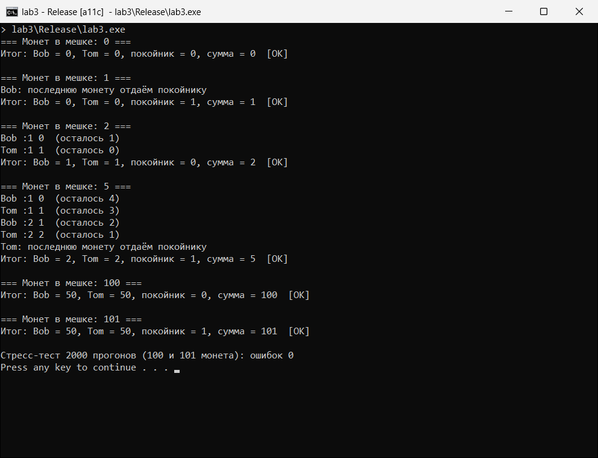
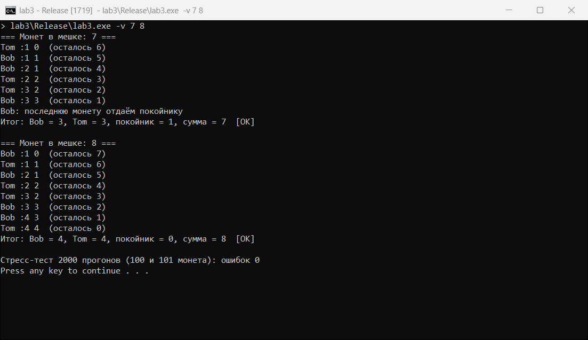
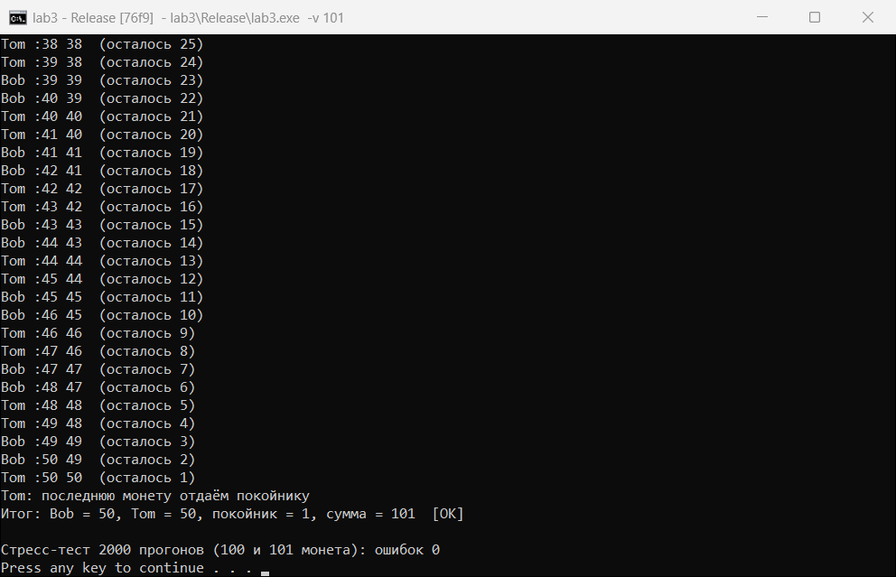

# Лабораторная №3. 100 и 1 монета

**Студент:** Пряников Максим Андреевич

**ОС:** Windows 11 Pro (сборка 26200), 8 логических ядер

**IDE:** Visual Studio Community 2026 (версия 18.12), компилятор MSVC 19.52, CMake 4.3, сборка x64

## Задача

Два вора, Боб и Том, в двух потоках делят монеты из общего мешка `coins`. Брать можно только по одной монете и строго по очереди. Если монет нечётное число, последняя достаётся покойнику; сумма всех монет не меняется. Для синхронизации разрешён только классический `std::mutex`.

## Решение

Общие переменные: `coins`, `Bob_coins`, `Tom_coins`, `Dead_coins` и один мьютекс `m`. Оба потока выполняют одну функцию:

```cpp
void coin_sharing(std::string name, int& thief_coins, int& companion_coins)
```

Бобу передаются `(Bob_coins, Tom_coins)`, Тому — наоборот. В цикле вор захватывает мьютекс и смотрит на состояние:

1. `coins == 0` — мешок пуст, выходим.
2. `coins == 1` и у воров поровну — последнюю монету отдаём покойнику (`Dead_coins++`), выходим.
3. `thief_coins <= companion_coins` — берём одну монету: `coins--`, `thief_coins++`, печатаем шаг.
4. Иначе (у меня уже больше, чем у подельника) — ничего не берём, сейчас его очередь.

После этого мьютекс освобождается и вызывается `std::this_thread::yield()`, чтобы подельник мог сделать свой ход.

**Почему это работает.** Условие `thief_coins <= companion_coins` заменяет булевы флаги очерёдности. Вор, который взял монету, получает на одну больше и не может взять следующую, пока подельник не сравняет счёт. Поэтому разница между ворами никогда не больше 1, и берут они строго по очереди, независимо от того, как планировщик переключает потоки.

Последняя монета: когда в мешке осталась одна монета, возможны два случая. Если у воров поровну — всего монет было нечётное число, монета уходит покойнику. Если у одного на монету меньше — всего было чётное число, и эту монету берёт отстающий по обычному правилу. Проверка и изменение всех переменных выполняются под одним мьютексом, поэтому два вора не могут одновременно увидеть «последнюю» монету и оба её забрать.

Для 0 монет оба потока сразу выходят; для 1 монеты она сразу уходит покойнику.

## Результаты

Запуск для количеств из задания: 0, 1, 2, 5, 100, 101. Для небольших мешков печатается каждый шаг (имя вора, его монеты, монеты подельника, остаток), для 100 и 101 — только итог. В конце — стресс-тест: по 1000 прогонов для 100 и 101 монеты с проверкой, что у воров поровну, сумма сохранилась, а покойник получил `total % 2` монет.

- 0 монет: Bob 0, Tom 0, покойник 0
- 1 монета: Bob 0, Tom 0, покойник 1
- 2 монеты: Bob 1, Tom 1, покойник 0
- 5 монет: Bob 2, Tom 2, покойник 1
- 100 монет: Bob 50, Tom 50, покойник 0
- 101 монета: Bob 50, Tom 50, покойник 1
- стресс-тест, 2000 прогонов: ошибок 0



Пошаговый вывод для 7 и 8 монет (ключ `-v` включает печать шагов, числа — свои количества монет): видно, что воры берут строго по очереди, а кто начнёт первым и кто отдаст монету покойнику — решает планировщик.



То же для 101 монеты (`lab3.exe -v 101`), в окне виден конец дележа: воры доходят до 50 монет каждый, последняя уходит покойнику.



## Вывод

Одного мьютекса достаточно, чтобы и защитить общие данные, и задать порядок действий потоков: порядок определяется не тем, кто первым захватил мьютекс, а условием на общее состояние, которое проверяется внутри критической секции. Недостаток такого подхода — активное ожидание: поток, чья очередь ещё не пришла, всё равно крутится в цикле, захватывая и отпуская мьютекс. С условной переменной ожидание было бы пассивным, но по условию она запрещена.
