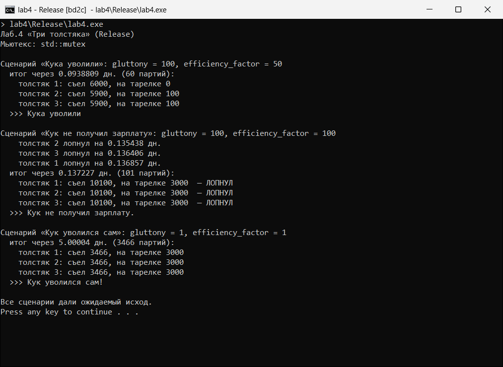

# Лабораторная №4. Три толстяка

**Студент:** Пряников Максим Андреевич

**ОС:** Windows 11 Pro (сборка 26200), 8 логических ядер

**IDE:** Visual Studio Community 2026 (версия 18.12), компилятор MSVC 19.52, CMake 4.3, сборка x64

## Задача

Три толстяка, каждый в своём потоке, едят наггетсы со своей тарелки (в начале по 3000). Повар Кук в четвёртом потоке докладывает наггетсы сразу на три тарелки. Исходы:

- у кого-то из толстяков тарелка опустела — **Кука уволили**;
- все трое съели больше 10 000 и лопнули — **Кук не получил зарплату**;
- прошло 5 дней (1 день = 1 секунда), и ничего из этого не случилось — **Кук уволился сам**.

Нужно подобрать три набора `gluttony` / `efficiency_factor`, каждый из которых гарантирует свой исход.

## Решение

Модель описана в `fatties.h` (класс `Table`), `main.cpp` прогоняет три сценария. Общие данные — тарелки `dish_[3]`, съеденное `eaten_[3]`, признаки «жив» `alive_[3]` и флаги `ate_[3]` — защищены одним `std::mutex`.

Флаг `ate_[k]` означает «толстяк k уже съел свою порцию из партии, которая сейчас на столе». В начале все флаги `true`: новой партии ещё нет, первым ходит Кук.

**Кук** в цикле `while (outcome_ == Outcome::None)` под мьютексом проверяет, прошло ли 5 дней (по `steady_clock`), и смотрит на флаги. Если все живые толстяки уже съели (`ate_[k] == true`), он кладёт `efficiency_factor` наггетсов на каждую тарелку и сбрасывает флаги в `false`. Пока он раскладывает, толстяки ждут на мьютексе («чтобы не откусить ему руки»). Затем Кук отпускает мьютекс и готовит следующую партию — `sleep_for(1 мс)` вне критической секции.

**Толстяк** в цикле `while (outcome_ == Outcome::None && alive_[k])`: если его флаг `false` (на столе новая партия), съедает `gluttony` наггетсов (или сколько осталось) и ставит флаг в `true`. Если съел больше 10 000 — лопается; если лопнули все — исход «не получил зарплату». Если тарелка опустела — исход «уволили».

Условия обоих циклов читают общие данные, поэтому проверяются под мьютексом: мьютекс захватывается перед первой проверкой и снова в конце каждой итерации, а внутри тела отпускается.

Получается строгое чередование «Кук положил — все трое съели — Кук положил…», и результат зависит только от коэффициентов, а не от того, как планировщик переключает потоки. Счётчик `batches_` в синхронизации не участвует — он нужен только чтобы вывести, сколько партий выложил Кук.

## Вопросы про yield

**Почему одного yield недостаточно?** `std::this_thread::yield()` — только подсказка планировщику: «можно отдать остаток моего кванта другому потоку». Она не гарантирует, какой поток выполнится следующим, и вообще не гарантирует переключения: если есть свободное ядро, `yield` может сразу вернуть управление тому же потоку. Значит, порядок «Кук положил — толстяки съели» с помощью `yield` не задать. Его задают флаги `ate_[k]`, которые проверяются под мьютексом: поток, чья очередь не пришла, просто ничего не делает на этой итерации, сколько бы раз он ни получил процессор.

**Мьютекс стандартный, не спинлок. Что даёт этот yield?** `std::mutex` усыпляет поток, только пока мьютекс занят. Но здесь поток ждёт не мьютекс, а условие: Кук — пока все съедят, толстяк — пока Кук положит новую партию. Это ожидание сделано опросом в цикле «захватил мьютекс → проверил флаги → очередь не моя → отпустил». Без `yield` поток сразу снова захватывает мьютекс. В Windows `std::mutex` построен на SRW-блокировке, а она не гарантирует справедливость и очередь FIFO, поэтому тот же поток может много раз подряд перехватывать мьютекс у того, чья очередь на самом деле пришла, и при этом впустую грузить ядро. `yield` после `unlock` отдаёт остаток кванта, и поток, который должен ходить, быстрее получает процессор и мьютекс.

Это всё равно активное ожидание, просто менее расточительное. Правильнее было бы ждать на `std::condition_variable`: поток засыпает до `notify`, когда условие может стать истинным. В задании прямо предложен вариант с дополнительными переменными и `yield`, поэтому сделано так.

## Подбор коэффициентов

Обозначим `g = gluttony`, `e = efficiency_factor`. За одну партию тарелка меняется на `e − g`, съеденное растёт на `g`.

**1. Кука уволили: g = 100, e = 50.** Каждую партию тарелка теряет 50 наггетсов: 3000 / 50 = 60 партий до пустой тарелки. К этому моменту толстяк съел 60 · 100 = 6000 — меньше 10 000, лопнуть он не успевает. Исход гарантирован при `g > e` и `3000 / (g − e) < 10000 / g`.

**2. Кук не получил зарплату: g = 100, e = 100.** Кук кладёт ровно столько, сколько съедают, тарелки всегда возвращаются к 3000 и не пустеют. Толстяк превышает 10 000 на 101-й партии (10 100). Все трое едят одинаково и лопаются на одной и той же партии. Исход гарантирован при `e ≥ g` и достаточно большом `g`, чтобы 10000 / g партий уложились в 5 дней.

**3. Кук уволился сам: g = 1, e = 1.** Тарелки не пустеют (`e ≥ g`). Кук тратит на партию не меньше 1 мс (`sleep_for` спит не меньше заданного времени), значит за 5 секунд будет не больше 5000 партий, и каждый толстяк съест не больше 5000 — меньше 10 000. Ни одно из первых двух условий выполниться не может, через 5 дней Кук уходит сам.

Сколько на самом деле длится `sleep_for(1 мс)`, зависит от разрешения системного таймера Windows. В этих запусках вышло примерно 1,4–1,5 мс (около 3300–3700 партий за 5 дней). В одном из прошлых запусков было около 15,6 мс — стандартный период таймера, когда его никто не ускорил, — и тогда за 5 дней выходило около 320 партий. На гарантии это не влияет: для сценария 3 важна только нижняя граница сна, а сценариям 1 и 2 нужно всего 60 и 101 партию, что даже при 15,6 мс на партию укладывается в 0,9 и 1,6 дня.

## Результаты

- g = 100, e = 50: примерно через 0,09 дня (60 партий) у одного из толстяков тарелка пуста, съедено 6000 — Кука уволили.
- g = 100, e = 100: примерно через 0,14–0,16 дня (101 партия) все трое съели по 10 100 и лопнули, на тарелках по 3000 — Кук не получил зарплату.
- g = 1, e = 1: через 5,0 дня (3310 партий в Debug, 3466 в Release) каждый съел столько же, на тарелках по 3000 — Кук уволился сам.

В первом сценарии у одного толстяка съедено 6000, а у двух других 5900: исход фиксируется в момент, когда первая тарелка опустела, и двое остальных не успевают съесть порцию из этой партии. Кто из троих окажется первым, зависит от планировщика, на исход это не влияет.

Дополнительно программа запускалась как `lab4.exe 5` (каждый сценарий по пять раз) в Debug и Release — исходы во всех прогонах совпали с ожидаемыми.
