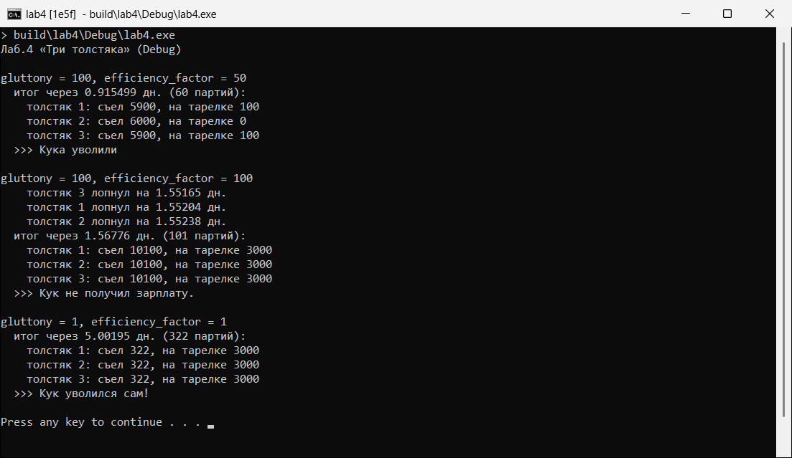

# Лабораторная №4. Три толстяка

**Студент:** Пряников Максим Андреевич

**ОС:** Windows 11 Pro (сборка 26200), 8 логических ядер

**IDE:** Visual Studio Community 2026 (версия 18.12), компилятор MSVC 19.52, CMake 4.3, сборка x64

## Задача

Три толстяка, каждый в своём потоке, едят наггетсы со своей тарелки (в начале по 3000). Повар Кук в четвёртом потоке докладывает наггетсы сразу на три тарелки. Исходы:

- у кого-то из толстяков тарелка опустела — **Кука уволили**;
- все трое съели больше 10 000 и лопнули — **Кук не получил зарплату**;
- прошло 5 дней (1 день = 1 секунда), и ничего из этого не случилось — **Кук уволился сам**.

Нужно подобрать три набора `gluttony` / `efficiency_factor`, каждый из которых гарантирует свой исход.

## Решение

Весь код в `main.cpp`. Общие данные — глобальные переменные: тарелки `dish1..dish3`, съеденное `eaten1..eaten3`, флаги `ate1..ate3`, коэффициенты `gluttony` и `efficiency_factor`, счётчик партий `batches` и исход `result` (пока он `nullptr`, всё продолжается). Отдельного признака «жив» нет: толстяк лопнул, если у него `eaten > 10000`. Все общие данные защищены одним `std::mutex m`, захват через `m.lock()` / `m.unlock()`. Потоки — обычные функции `cook()` и `fatty(n, dish, eaten, ate)`. Функция `run(g, e)` выставляет коэффициенты, сбрасывает тарелки и флаги, запускает четыре потока, ждёт их через `join()` и печатает итог. `main()` вызывает `run()` три раза, в конце `system("pause")`.

Флаг `ate1..ate3` означает «толстяк k уже съел свою порцию из партии, которая сейчас на столе». В начале все флаги `true`: новой партии ещё нет, первым ходит Кук.

**Кук** крутится в `while (true)`. На каждой итерации он захватывает мьютекс и выходит через `break`, если исход уже есть (`result`) или прошло 5 дней (`days() >= 5` по `steady_clock`, тогда он сам ставит «Кук уволился сам!»). Если все флаги `ate1..ate3` равны `true`, он кладёт `efficiency_factor` наггетсов на каждую тарелку, сбрасывает флаги в `false` (у лопнувшего флаг сразу `true`, он больше не ест), увеличивает `batches`, отпускает мьютекс и готовит следующую партию — `sleep_for(2 мс)` уже вне мьютекса. Если кто-то ещё не доел, Кук отпускает мьютекс и делает `yield()`. Пока Кук раскладывает, мьютекс занят, и толстяки ждут («чтобы не откусить ему руки»).

**Толстяк** тоже крутится в `while (true)` и выходит через `break`, если есть `result` или он сам лопнул (`eaten > 10000`). Если его флаг `false` (на столе новая партия), он съедает `gluttony` наггетсов (или сколько осталось) и ставит флаг в `true`. Если съел больше 10 000, он печатает, что лопнул, и если лопнули все трое, ставит «Кук не получил зарплату.». Иначе, если тарелка опустела, ставит «Кука уволили». После `unlock()` толстяк делает `yield()`.

Мьютекс захватывается в начале каждой итерации и отпускается либо перед `yield` / `sleep_for`, либо перед `break`. Поэтому все проверки общих данных, в том числе условия выхода, идут под мьютексом, а спящий Кук мьютекс не держит.

Получается строгое чередование «Кук положил — все трое съели — Кук положил…», и результат зависит только от коэффициентов, а не от того, как планировщик переключает потоки. Счётчик `batches` в синхронизации не участвует, он нужен только чтобы вывести, сколько партий выложил Кук.

## Вопросы про yield

**Почему одного yield недостаточно?** `std::this_thread::yield()` — только подсказка планировщику: «можно отдать остаток моего кванта другому потоку». Она не гарантирует, какой поток выполнится следующим, и вообще не гарантирует переключения: если есть свободное ядро, `yield` может сразу вернуть управление тому же потоку. Значит, порядок «Кук положил — толстяки съели» с помощью `yield` не задать. Его задают флаги `ate1..ate3`, которые проверяются под мьютексом: поток, чья очередь не пришла, просто ничего не делает на этой итерации, сколько бы раз он ни получил процессор.

**Мьютекс стандартный, не спинлок. Что даёт этот yield?** `std::mutex` усыпляет поток, только пока мьютекс занят. Но здесь поток ждёт не мьютекс, а условие: Кук — пока все съедят, толстяк — пока Кук положит новую партию. Это ожидание сделано опросом в цикле «захватил мьютекс → проверил флаги → очередь не моя → отпустил». Без `yield` поток сразу снова захватывает мьютекс. В Windows `std::mutex` построен на SRW-блокировке, а она не гарантирует справедливость и очередь FIFO, поэтому тот же поток может много раз подряд перехватывать мьютекс у того, чья очередь на самом деле пришла, и при этом впустую грузить ядро. `yield` после `unlock` отдаёт остаток кванта, и поток, который должен ходить, быстрее получает процессор и мьютекс.

Это всё равно активное ожидание, просто менее расточительное. Правильнее было бы ждать на `std::condition_variable`: поток засыпает до `notify`, когда условие может стать истинным. В задании прямо предложен вариант с дополнительными переменными и `yield`, поэтому сделано так.

## Подбор коэффициентов

Обозначим `g = gluttony`, `e = efficiency_factor`. За одну партию тарелка меняется на `e − g`, съеденное растёт на `g`.

**1. Кука уволили: g = 100, e = 50.** Каждую партию тарелка теряет 50 наггетсов: 3000 / 50 = 60 партий до пустой тарелки. К этому моменту толстяк съел 60 · 100 = 6000 — меньше 10 000, лопнуть он не успевает. Исход гарантирован при `g > e` и `3000 / (g − e) < 10000 / g`.

**2. Кук не получил зарплату: g = 100, e = 100.** Кук кладёт ровно столько, сколько съедают, тарелки всегда возвращаются к 3000 и не пустеют. Толстяк превышает 10 000 на 101-й партии (10 100). Все трое едят одинаково и лопаются на одной и той же партии. Исход гарантирован при `e ≥ g` и достаточно большом `g`, чтобы 10000 / g партий уложились в 5 дней.

**3. Кук уволился сам: g = 1, e = 1.** Тарелки не пустеют (`e ≥ g`). Кук тратит на партию не меньше 2 мс (`sleep_for` спит не меньше заданного времени), значит за 5 секунд будет не больше 2500 партий, и каждый толстяк съест не больше 2500 — меньше 10 000. Ни одно из первых двух условий выполниться не может, через 5 дней Кук уходит сам.

Сколько на самом деле длится `sleep_for(2 мс)`, зависит от разрешения системного таймера Windows. В моих запусках одна партия занимает около 15,5 мс (5 с / ~322 партии). Это стандартный период таймера ≈15,6 мс, когда его никто не ускорил: сон округляется вверх до ближайшего тика. Если какая-то программа ускорит таймер, `sleep_for(2 мс)` станет короче и партий за 5 дней будет больше, но всё равно не больше 2500. Поэтому число партий в сценарии 3 зависит от разрешения таймера, а исход от этого не зависит: для сценария 3 важна только нижняя граница сна, а сценариям 1 и 2 нужно всего 60 и 101 партия, что даже при 15,6 мс на партию укладывается примерно в 0,9 и 1,6 дня.

## Результаты

| Сценарий | Debug | Release | Исход |
|---|---|---|---|
| g = 100, e = 50 | 0,92 дн., 60 партий | 0,92 дн., 60 партий | Кука уволили |
| g = 100, e = 100 | 1,57 дн., 101 партия | 1,57 дн., 101 партия | Кук не получил зарплату. |
| g = 1, e = 1 | 5,00 дн., 322 партии | 5,01 дн., 323 партии | Кук уволился сам! |

- g = 100, e = 50: у одного толстяка тарелка пуста и съедено 6000, у двух других съедено по 5900 и на тарелке по 100 — Кука уволили.
- g = 100, e = 100: все трое лопнули почти одновременно (разница меньше 0,001 дня), съели по 10 100, на тарелках по 3000 — Кук не получил зарплату.
- g = 1, e = 1: каждый съел столько, сколько было партий (322 в Debug, 323 в Release), на тарелках по 3000 — Кук уволился сам.

В первом сценарии у одного толстяка съедено 6000, а у двух других 5900: исход фиксируется в момент, когда первая тарелка опустела, и двое остальных не успевают съесть порцию из этой партии. Кто из троих окажется первым, зависит от планировщика (в этих запусках это был толстяк 2, в других — бывал и 1, и 3), на исход это не влияет.

## Возможные вопросы

**Почему `gluttony` и `efficiency_factor` не `const`, хотя в ТЗ `const int ... = 3`?** Мне нужно в одной программе прогнать три набора коэффициентов, поэтому `run()` перед запуском потоков присваивает им новые значения. Пока потоки работают, их никто не меняет, потоки их только читают, так что на время одного сценария это фактически константы.

**Что, если толстяк одной порцией и лопнул, и опустошил тарелку?** Из-за `else if` засчитается только «лопнул». На выбранных коэффициентах такого не бывает: в сценарии 2 тарелка после каждой партии снова 3000, а в сценарии 1 первой пустеет тарелка, когда съедено 6000, то есть задолго до 10 000.

**Почему толстяки грузят процессор?** Пока Кук спит, толстяки крутятся в цикле «lock → проверка флага → unlock → yield». `yield` только отдаёт остаток кванта, поток сразу снова готов к выполнению и опять проверяет флаг — это активное ожидание. Чтобы поток по-настоящему спал до новой партии, нужна условная переменная, но условных переменных в этой лабе нет, а ТЗ прямо подсказывает сделать через дополнительные переменные и `yield`, поэтому так и сделано.
