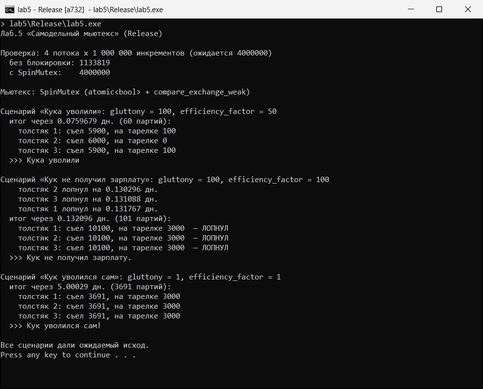
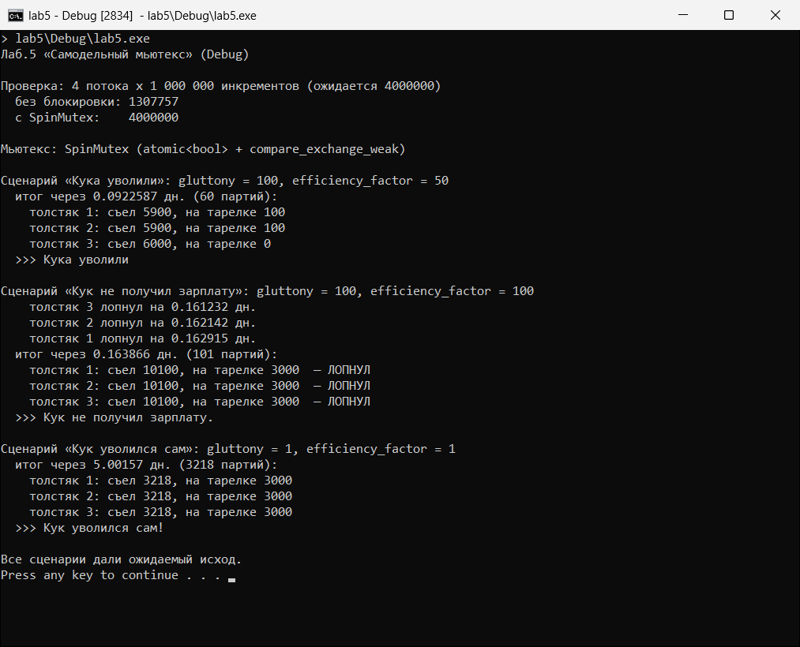

# Лабораторная №5. Самодельный мьютекс

**Студент:** Пряников Максим Андреевич

**ОС:** Windows 11 Pro (сборка 26200), 8 логических ядер

**IDE:** Visual Studio Community 2026 (версия 18.12), компилятор MSVC 19.52, CMake 4.3, сборка x64

## Задача

Реализовать собственный мьютекс — класс с методами `lock` и `unlock` — на атомарной переменной и `compare_exchange` и подставить его вместо `std::mutex` в решение лабораторной №4. Поведение программы должно сохраниться.

## Реализация

Класс `SpinMutex` (файл `spin_mutex.h`) хранит одно поле `std::atomic<bool> locked_`: `false` — свободен, `true` — захвачен.

```cpp
void lock() {
    bool expected = false;
    while (!locked_.compare_exchange_weak(expected, true,
                                          std::memory_order_acquire,
                                          std::memory_order_relaxed)) {
        expected = false;
        while (locked_.load(std::memory_order_relaxed))
            std::this_thread::yield();
    }
}

void unlock() {
    locked_.store(false, std::memory_order_release);
}
```

**lock.** `compare_exchange_weak(expected, true)` атомарно делает следующее: если `locked_ == expected` (то есть `false`), записывает `true` и возвращает `true` — мьютекс захвачен. Иначе возвращает `false` и записывает в `expected` текущее значение. Проверка и запись — одна неделимая операция процессора, поэтому два потока не могут одновременно увидеть «свободно» и оба захватить мьютекс: выиграет только один.

После неудачи `expected` нужно вернуть в `false`, иначе следующая попытка сравнивала бы с `true`. Вариант `weak` может изредка вернуть `false` даже при свободном мьютексе (ложный отказ), но в цикле это не страшно, и он дешевле `strong`.

Пока мьютекс занят, поток только читает флаг и вызывает `yield()`, отдавая квант другим потокам, — так ожидающие не мешают владельцу и не гоняют кэш-линию лишними записями.

**unlock** записывает `false`. Порядок памяти `acquire` при захвате и `release` при освобождении гарантирует, что всё, что владелец записал внутри критической секции, увидит следующий захвативший поток.

Копирование мьютекса запрещено. Для полноты добавлен `try_lock` на `compare_exchange_strong`.

**Отличие от std::mutex.** Это спин-блокировка: ожидающий поток не засыпает в ядре, а активно опрашивает флаг. Для коротких критических секций, как здесь, это нормально; для длинных — тратит процессорное время впустую. Также нет очереди ожидающих и защиты от повторного захвата тем же потоком.

## Подстановка в лабораторную №4

Модель толстяков в `lab4/fatties.h` — шаблон `Table<Mutex>`, тип мьютекса — параметр. В лабораторной №4 используется `Table<std::mutex>`, здесь — `Table<SpinMutex>`. Остальной код не менялся: те же потоки, та же логика чередования, те же три набора коэффициентов.

**Зависимость от проекта 4 в CMake.** В `lab4/CMakeLists.txt` модель объявлена отдельной header-only библиотекой:

```cmake
add_library(fatties INTERFACE)
target_sources(fatties INTERFACE ${CMAKE_CURRENT_SOURCE_DIR}/fatties.h)
target_include_directories(fatties INTERFACE ${CMAKE_CURRENT_SOURCE_DIR})
```

Её используют обе программы, и лаб.4, и лаб.5. В `lab5/CMakeLists.txt` зависимость задана явно:

```cmake
target_link_libraries(lab5 PRIVATE fatties)
```

Через неё lab5 получает путь к `lab4/fatties.h`. Если библиотеку `fatties` убрать из lab4, CMake на этапе конфигурации сообщит об ошибке в lab5, а не молча соберёт что-то другое. Корневой `CMakeLists.txt` подключает `lab4` раньше `lab5`.

## Результаты

Сначала отдельная проверка самого мьютекса: 4 потока по 1 000 000 раз увеличивают общий счётчик.

- без блокировки: 1 133 819 (Release) и 1 307 757 (Debug) вместо 4 000 000 — обновления теряются из-за гонки;
- с `SpinMutex`: ровно 4 000 000 в обеих конфигурациях.

Затем три сценария из лабораторной №4 — исходы те же, что и со `std::mutex`:

- g = 100, e = 50: 60 партий, тарелка пуста — Кука уволили;
- g = 100, e = 100: 101 партия, все трое съели по 10 100 и лопнули — Кук не получил зарплату;
- g = 1, e = 1: 5 дней (3218 партий в Debug, 3691 в Release) — Кук уволился сам.

Число партий в первых двух сценариях и съеденное совпадают с лабораторной №4. В третьем число партий зависит от того, сколько на самом деле длится `sleep_for(1 мс)` (это разобрано в отчёте к лаб.4), но остаётся меньше 5000, поэтому исход тот же.





Дополнительно программа запускалась как `lab5.exe 5` (каждый сценарий по пять раз) в Debug и Release — исходы во всех прогонах ожидаемые.

## Вывод

Самодельный мьютекс на `atomic<bool>` и `compare_exchange_weak` обеспечивает взаимное исключение: счётчик из четырёх потоков сходится точно, а решение задачи о трёх толстяках ведёт себя так же, как со стандартным мьютексом.
