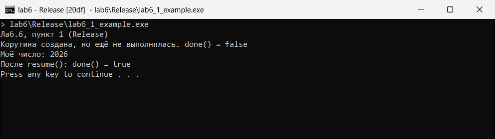
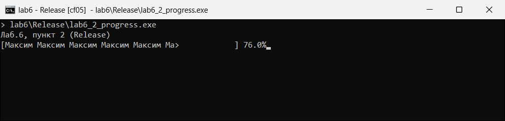
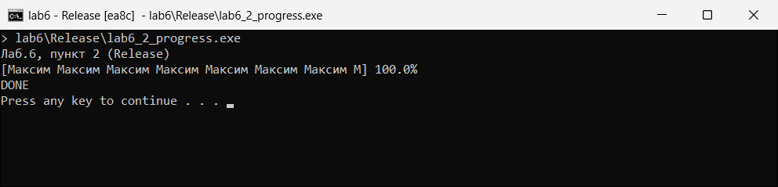

# Лабораторная №6. Корутины

**Студент:** Пряников Максим Андреевич

**ОС:** Windows 11 Pro (сборка 26200), 8 логических ядер

**IDE:** Visual Studio Community 2026 (версия 18.12), компилятор MSVC 19.52 (стандарт C++20), CMake 4.3, сборка x64

Проект — CMake, две программы: `lab6_1_example` (example.cpp) и `lab6_2_progress` (progress.cpp).

## Пункт 1. Пример из документации со своим числом

Пример с cppreference переписан, вместо исходного числа задано своё — **2026**.

Как это работает:

- `promise` — объект-обещание, через который компилятор управляет корутиной. `get_return_object()` создаёт то, что получит вызывающий код: `coroutine` — обёртку над `std::coroutine_handle<promise>`.
- `coroutine` содержит `using promise_type = ::promise` — по этому имени компилятор находит тип обещания для функции, возвращающей `coroutine`.
- `initial_suspend()` возвращает `suspend_always`: корутина приостанавливается сразу после создания, тело не выполняется до `resume()`.
- `final_suspend()` тоже возвращает `suspend_always`: после `co_return` кадр корутины не уничтожается сам, поэтому в конце нужен явный `destroy()`.
- Тело корутины — лямбда ` -> coroutine { ... co_return; }`, которая вызывается сразу с аргументом `(2026)`.

Чтобы было видно, что корутина приостановлена на старте, добавлен вывод `done()` до и после `resume()`: сообщение «Моё число: 2026» появляется только после `resume()`.

## Пункт 2. Прогресс-бар с именем

Код из методички собран в `progress.cpp`:

- `promise_type` хранит `current_value` — текущий прогресс; `yield_value(int)` вызывается на каждом `co_yield`, сохраняет значение и приостанавливает корутину;
- `task` — владеющая обёртка над `coroutine_handle` с методами `resume()`, `done()`, `get_value()`; в деструкторе уничтожает кадр корутины;
- специализация `std::coroutine_traits<task, int>` связывает функцию вида `task f(int)` с типом обещания;
- корутина `long_computation(int steps)` на каждом шаге «работает» (спит 50 мс) и отдаёт номер шага через `co_yield`;
- `main` в цикле вызывает `resume()`, читает прогресс и перерисовывает шкалу, пока корутина не завершится.

**Моя шкала.** Вместо одинаковых символов `=` шкала заполняется моим именем — «Максим», повторяющимся по кругу через пробел; на границе заполненной части остаётся `>`. Имя задаётся в одном месте — в `student.cmake` (переменная `STUDENT_NAME`) — и передаётся в программу определением препроцессора.

Имя написано кириллицей, а в UTF-8 каждая русская буква занимает два байта. Если считать шкалу в байтах, она разъезжается, а буква может быть разрезана пополам. Поэтому функция `utf8_chars` сначала разбивает имя на отдельные символы, и `print_progress` строит шкалу ровно из 50 символов. Консоль переключается в UTF-8 вызовом `SetConsoleOutputCP(CP_UTF8)`, исходники компилируются с ключом `/utf-8`.

Отличия от кода методички:

- в специализации `coroutine_traits` написано `using promise_type = ::promise_type;` — с явным `::`, чтобы было однозначно видно, что справа стоит глобальный тип, а не само объявляемое имя (вариант из методички без `::` компилятор MSVC тоже принимает — проверено);
- в цикле `main` после `resume()` добавлена проверка `if (coro.done()) break;` — последний `resume()` доходит до `co_return` и нового значения уже не даёт;
- у `task` запрещено копирование, чтобы кадр корутины не был уничтожен дважды.

В процессе работы (76 %):

После завершения (100 %):

## Вывод

Корутина — функция, которая может приостановиться (`co_yield`, `co_await`) и позже продолжиться с того же места, сохранив локальные переменные. В отличие от потоков из прошлых лабораторных, здесь нет параллельности и планировщика ОС: всё выполняется в одном потоке, а управление передаётся явно — `resume()` снаружи и `co_yield` изнутри. Поэтому не нужны мьютексы, и порядок выполнения полностью детерминирован. В C++20 готовых типов корутин нет — есть только механизм (`promise_type`, `coroutine_handle`, awaitable-объекты), поведение приходится описывать самому, что и сделано в обоих пунктах.
