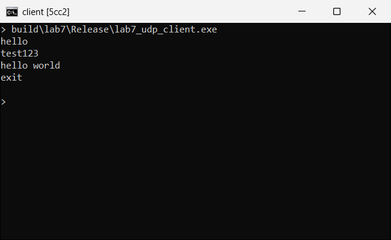
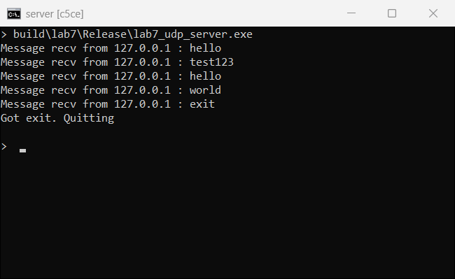
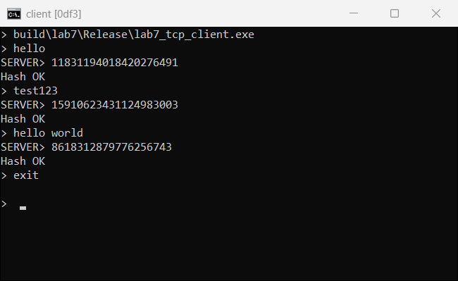
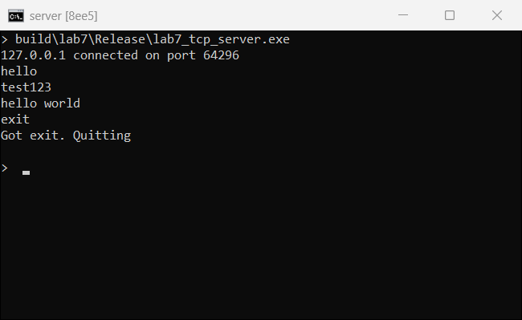
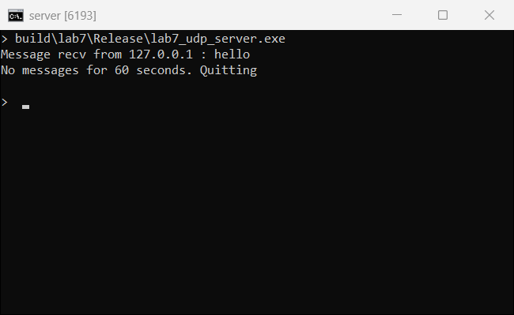
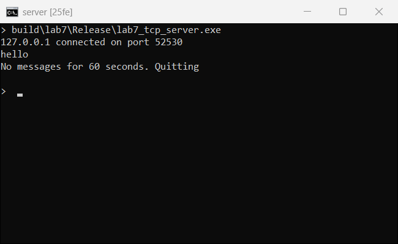

# Лабораторная №7. UDP и TCP сокеты

**Студент:** Пряников Максим Андреевич

**ОС:** Windows 11 Pro (сборка 26200), 8 логических ядер

**IDE:** Visual Studio Community 2026 (версия 18.12), компилятор MSVC 19.52, CMake 4.3, сборка x64

## Задача

По ТЗ нужно собрать UDP-сервер и UDP-клиент из кода задания (WinSock), запустить их и проверить отправку сообщений. Самостоятельно — сделать то же для TCP (`SOCK_STREAM` вместо `SOCK_DGRAM`), придумать свои условия выхода из цикла сервера и клиента (по спецсимволу и/или по времени) и отправлять обратно хеш сообщения.

В папке `lab7` четыре программы: `udp_server.cpp`, `udp_client.cpp`, `tcp_server.cpp`, `tcp_client.cpp`. Каждая собирается в свой exe (`lab7_udp_server`, `lab7_udp_client`, `lab7_tcp_server`, `lab7_tcp_client`).

## Сокеты и их атрибуты

Перед работой с сокетами на Windows нужно запустить WinSock: `WSAStartup(MAKEWORD(2, 2), ...)` (версия 2.2), а в конце вызвать `WSACleanup()`. Библиотеку `ws2_32.lib` я подключаю через `#pragma comment(lib, "ws2_32.lib")`, как в задании, — тогда не нужно настраивать компоновку в проекте. В `CMakeLists.txt` я на всякий случай тоже указал `target_link_libraries(... ws2_32)`.

Сокет создаётся вызовом `socket(домен, тип, протокол)`, и эти три атрибута не меняются, пока сокет существует:

- **домен** `AF_INET` — интернет-домен, адреса IPv4;
- **тип** `SOCK_DGRAM` — UDP, данные идут отдельными датаграммами (сообщениями); `SOCK_STREAM` — TCP, данные идут потоком байтов по установленному соединению;
- **протокол** `0` — система сама выбирает протокол по типу: для `SOCK_DGRAM` это UDP, для `SOCK_STREAM` — TCP.

Во всех программах порт 54000. Клиент обращается к `127.0.0.1` (адрес переводится в байты через `inet_pton`), сервер привязывается (`bind`) к любому адресу машины: `ADDR_ANY` в UDP-сервере и `INADDR_ANY` в TCP-сервере (это одно и то же значение 0). Порт переводится в сетевой порядок байтов через `htons`.

## UDP

**Сервер.** Создаёт сокет `SOCK_DGRAM`, привязывает его к порту 54000 и в цикле `while (true)` очищает буфер и структуру клиента, ждёт датаграмму через `recvfrom`, переводит адрес отправителя в строку через `inet_ntop` и печатает `Message recv from <ip> : <сообщение>`. Соединения нет, поэтому адрес отправителя приходит вместе с каждой датаграммой.

**Клиент.** Создаёт сокет `SOCK_DGRAM` и в цикле читает слово с консоли (`cin >> msg`) и отправляет его серверу через `sendto`. Если `sendto` вернул `SOCKET_ERROR`, печатает ошибку. Как сказано в ТЗ, успешный `sendto` не значит, что сообщение дошло, — только то, что его удалось отправить.

**Что я изменил в коде с картинок:**

- `void main()` заменил на `int main()`, а `return;` в ветках ошибок — на `return 1;`. `void main` не по стандарту C++, MSVC на него выдаёт предупреждение C4326.
- В `sendto` добавил приведение `(int)msg.size() + 1`: `size()` возвращает `size_t` (64 бита в x64), а параметр `int`, и при `/W4` MSVC предупреждает о потере данных.
- Выход по `exit`: клиент отправляет `exit` серверу и сразу выходит из цикла; сервер, получив `exit`, печатает `Got exit. Quitting` и выходит.
- Таймаут 60 секунд на сервере (подробно в разделе «Условия выхода»).

Конец ввода (EOF) в UDP-клиенте я не обрабатывал, оставил чтение как на картинке — клиент выходит только по `exit`.

## TCP

Код TCP взят из примеров сервера и клиента в конце ТЗ.

**Сервер.** Создаёт сокет `SOCK_STREAM`, делает `bind` на порт 54000 и `listen`, затем `accept` ждёт подключения клиента и возвращает новый сокет `clientSocket` для этого соединения. Сервер печатает, кто подключился (`127.0.0.1 connected on port ...`), и закрывает слушающий сокет `listening`, как в примере, — поэтому он обслуживает только одного клиента. Дальше в цикле `recv` читает сообщение, сервер печатает его и вместо эха отправляет обратно хеш.

**Клиент.** Делает `connect` на `127.0.0.1:54000`, затем в цикле печатает приглашение `> `, читает строку через `getline`, отправляет её одним `send` и ждёт ответ через `recv`.

**Хеш.** Сервер считает хеш принятой строки и отправляет его текстом:

```cpp
string reply = to_string(hash<string>{}(string(buf)));
send(clientSocket, reply.c_str(), (int)reply.size() + 1, 0);
```

Клиент печатает ответ (`SERVER> ...`), считает хеш своей строки так же и сравнивает:

```cpp
string myHash = to_string(hash<string>{}(userInput));
if (string(buf) == myHash) cout << "Hash OK" << endl;
else cout << "Hash MISMATCH" << endl;
```

На `exit` хеш не отправляется: клиент после отправки `exit` сразу выходит, сервер тоже.

**Что я изменил в примерах из ТЗ:**

- `void main()` → `int main()`, `return;` → `return 1;` (C4326), приведения `(int)userInput.size() + 1` и `htons((u_short)port)` — чтобы не было предупреждений о сужении типа при `/W4`.
- Сервер вместо эха (`send(clientSocket, buf, ...)`) отправляет хеш, клиент его проверяет.
- Выход по `exit` у обоих и таймаут 60 секунд на сервере.
- В клиенте был цикл `do ... while (userInput.size() > 0)`, то есть выход по пустой строке. Я заменил его на `while (true)` с выходом по `exit`. Чтобы клиент не зацикливался, если ввод закончился без `exit` (EOF, Ctrl+Z, или ввод из файла/конвейера), добавил проверку результата `getline`:

  ```cpp
  if (!getline(cin, userInput))
  {
      break;
  }
  ```

- В `getnameinfo` последний аргумент `0` заменил на `NI_NUMERICHOST`. С `0` функция делает обратное разрешение адреса в имя и для `127.0.0.1` берёт имя из файла `C:\Windows\System32\drivers\etc\hosts`. На моей машине одна из установленных программ добавила туда свои имена для `127.0.0.1`, и сервер печатал одно из этих имён вместо адреса. С `NI_NUMERICHOST` адрес печатается цифрами: `127.0.0.1 connected on port …`.

## Условия выхода

| Программа | Условия выхода |
|---|---|
| UDP-сервер | пришло `exit`; 60 секунд нет датаграмм |
| UDP-клиент | введено `exit` (отправляется серверу) |
| TCP-сервер | пришло `exit`; 60 секунд нет сообщений; клиент разорвал соединение (`recv` вернул 0 → `Client disconnected`); ошибка `recv` |
| TCP-клиент | введено `exit` (отправляется серверу); конец ввода (EOF) |

`exit` — это мой «спецсимвол», а таймаут — выход по времени, оба варианта из ТЗ.

**Таймаут.** Делаю его через опцию сокета `SO_RCVTIMEO`. На Windows значение задаётся как `DWORD` в миллисекундах (в Linux это была бы структура `timeval`):

```cpp
DWORD timeout = 60000;
setsockopt(in, SOL_SOCKET, SO_RCVTIMEO, (const char*)&timeout, sizeof(timeout));
```

Если за 60 секунд ничего не пришло, `recvfrom`/`recv` возвращает `SOCKET_ERROR`, а `WSAGetLastError()` возвращает `WSAETIMEDOUT` (10060):

```cpp
if (WSAGetLastError() == WSAETIMEDOUT)
{
    cout << "No messages for 60 seconds. Quitting" << endl;
    break;
}
```

В UDP опция ставится на сам сокет сервера, поэтому отсчёт идёт сразу после запуска. В TCP я ставлю её на `clientSocket` после `accept`, поэтому 60 секунд считаются только после подключения клиента. Пока клиента нет, `accept` ждёт без ограничения времени.

## Результаты

Собирал Release x64, программы запускал из корня репозитория (`build\lab7\Release\...`), сервер и клиент — в двух разных окнах. Скриншоты снимал скриптом, который сам вводил строки в окно клиента, поэтому у окон нестандартные заголовки (вида `server [c5ce]`, `client [5cc2]`); приглашение `> ` перед строками в TCP-клиенте печатает сама программа.

### UDP

В клиенте ввёл `hello`, `test123`, `hello world`, `exit`.



Сервер напечатал пять сообщений, все от `127.0.0.1`: `hello`, `test123`, `hello`, `world`, `exit`, затем `Got exit. Quitting`. Клиент ничего в ответ не получает, а после `exit` тоже завершился.



Строка `hello world` пришла **двумя** сообщениями. Причина в клиенте с картинки: `cin >> msg` читает до пробела, поэтому из одной строки получилось два слова, `hello` и `world`, и на каждое был свой `sendto`, то есть две датаграммы.

### TCP

В клиенте ввёл те же строки.



На каждую строку клиент получил хеш и напечатал `Hash OK`:

| Строка | Хеш от сервера |
|---|---|
| `hello` | 11831194018420276491 |
| `test123` | 15910623431124983003 |
| `hello world` | 8618312879776256743 |

После `exit` ответа нет — клиент сразу завершился.



Сервер напечатал `127.0.0.1 connected on port 64296` (64296 — порт клиента, его выбрала система), затем `hello`, `test123`, `hello world`, `exit` и `Got exit. Quitting`. Здесь `hello world` пришло **одним** сообщением: TCP-клиент читает всю строку через `getline` и отправляет её одним `send`.

### Таймаут

UDP-сервер получил одно сообщение `hello`, после этого клиент молчал, и через 60 секунд сервер напечатал `No messages for 60 seconds. Quitting`.



TCP-сервер: клиент подключился (`127.0.0.1 connected on port 52530`), отправил `hello` и больше ничего не отправлял — через 60 секунд `No messages for 60 seconds. Quitting`.



### Запуск клиентов без сервера

Отдельно проверил, что будет, если сервер не запущен (скриншотов нет, вывод из консоли):

- TCP-клиент сразу завершился (код возврата 1) с сообщением `Can't connect to server, Err #10061`. 10061 — это `WSAECONNREFUSED`: на порту 54000 никто не слушает, и система отказала в подключении.
- UDP-клиент с вводом `hello world` и `exit` отправил три датаграммы и завершился с кодом 0 без единой ошибки — `sendto` успешно отправил их «в пустоту».

### Кириллица

Ещё проверил строку `привет`: она доходит и по UDP, и по TCP, хеш в TCP совпадает (`Hash OK`). Клиент и сервер работают в консолях с одной кодировкой, поэтому байты строки у них одинаковые и хеш получается один и тот же. Скриншота этой проверки нет.

## Ответы на вопросы

**Чем UDP отличается от TCP (по моим запускам).**

- В UDP нет соединения. Сервер печатает адрес отправителя у каждой датаграммы (`Message recv from 127.0.0.1 : ...`). Клиент ничего не получает в ответ и не знает, дошло ли сообщение. Если сервера нет, клиент всё равно «успешно» отправляет.
- В TCP сначала устанавливается соединение: сервер печатает `127.0.0.1 connected on port ...` один раз, при `accept`, дальше весь обмен идёт по этому соединению, и клиент получает ответ. Если сервера нет, `connect` сразу возвращает ошибку 10061. Мой TCP-сервер обслуживает одного клиента, потому что после `accept` закрывает слушающий сокет (как в примере ТЗ).
- UDP передаёт отдельные сообщения: одна `sendto` — одна датаграмма — один `recvfrom`. TCP передаёт поток байтов без границ между сообщениями. Один `recv` может вернуть часть сообщения или сразу несколько. У меня такого не было: схема «запрос → ответ» (клиент не отправляет следующую строку, пока не получит хеш), сообщения намного короче буфера 4096 и идут через `127.0.0.1`. Поэтому каждый `recv` возвращал ровно одну строку, и хеш сравнивался правильно. В общем случае нужно самому размечать границы сообщений, например читать до `'\0'` или передавать длину.

**«В TCP есть проверка, что сообщение доставлено. Верно ли содержание?»**

Не обязательно. Подтверждение (ACK) в TCP значит только то, что TCP-стек на компьютере получателя принял байты и берёт на себя ответственность за них. Это не значит, что программа-получатель их прочитала и правильно поняла: она могла упасть или обработать данные с ошибкой. Контрольная сумма TCP всего 16-битная и простая, некоторые искажения она пропускает. Поэтому в лабораторной я проверяю содержимое на уровне приложения: сервер считает хеш того, что он реально получил, и отправляет его обратно, а клиент сравнивает этот хеш с хешем своей строки. `Hash OK` значит, что сервер получил ровно ту строку, которую отправил клиент.

**«Зачем отправлять обратно?»**

Ответ с хешем — это подтверждение на уровне приложения: клиент узнаёт, что сообщение дошло до самой программы-сервера и что содержимое совпадает. По ТЗ так делают, когда данные особенно важны: в финансовых транзакциях (дополнительная проверка, цифровая подпись), при хранении и передаче больших файлов (MD5 или похожий хеш, чтобы заметить повреждение). Но, как сказано в ТЗ, гарантии нет и здесь: ответ тоже может не дойти. Тогда клиент не знает, что потерялось — сообщение или ответ. Для обычного трафика (веб, FTP, SSH) хватает встроенных механизмов TCP.

**Насколько надёжен мой хеш.** `std::hash<std::string>` не криптографический: в MSVC это 64-битный FNV-1a. Он подходит, чтобы заметить случайное искажение, но подделать строку с тем же хешем несложно. Кроме того, его результат зависит от реализации стандартной библиотеки: у GCC или Clang хеш той же строки будет другим. У меня хеши совпадают, потому что клиент и сервер собраны одним компилятором MSVC под x64. Для настоящей проверки целостности нужен криптографический хеш, например SHA-256 (MD5 из примера ТЗ уже тоже считается небезопасным).

## Вывод

Я собрал UDP- и TCP-клиент и сервер на WinSock под MSVC. UDP-сервер принимает отдельные датаграммы и видит адрес отправителя у каждой. UDP-клиент не получает подтверждений и «успешно» отправляет даже без сервера. TCP работает через соединение: без сервера `connect` даёт ошибку 10061, а с сервером каждое сообщение подтверждается хешем, и во всех запусках хеш совпал (`Hash OK`). Из обоих серверов можно выйти по `exit` и по таймауту 60 секунд (`SO_RCVTIMEO`, `WSAETIMEDOUT`), из TCP-сервера ещё по разрыву соединения, из TCP-клиента — по концу ввода.
