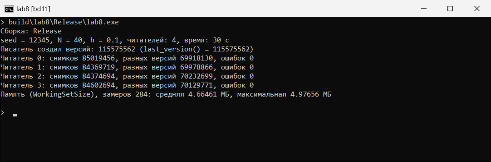
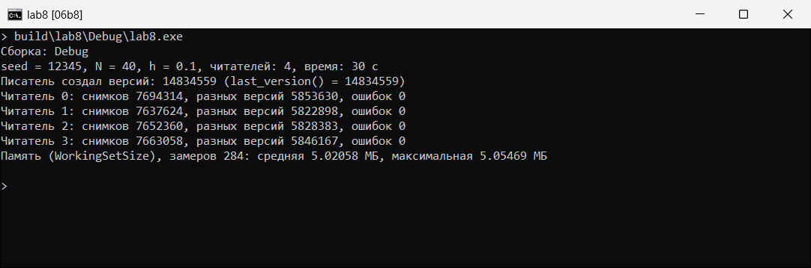

# Лабораторная №X «По ком звонит Колокольчик!» (lock-free стек)

**Студент:** Пряников Максим Андреевич

**ОС:** Windows 11 Pro (сборка 26200), 8 логических ядер

**IDE:** Visual Studio Community 2026 (версия 18.12), компилятор MSVC 19.52, CMake 4.3, сборка x64

## Задача

Нужно взять lock-free стек из лекции 8 (версионный стек: один писатель, несколько читателей), подставить в него тип `struct Position { double x; double y; }`, сделать писателя, который генерирует точки параболы y = −x² + 4x на отрезке от P1(0, 0) до P2(4, 0), снимает часть точек и снова добавляет, и не меньше 4 читателей, которые читают самую свежую версию стека и проверяют её на консистентность. Потом запустить эксперимент и описать, что получилось.

Файлы в папке `lab8`:

- `node.hpp`, `lockfree_stack.hpp` — код стека из лекции (что в нём поменял — ниже, в разделе «Что взято из лекции и что изменено»);
- `main.cpp` — мой тест: писатель, 4 читателя, проверка снимков, замер памяти;
- `CMakeLists.txt` — exe `lab8`, подключена библиотека `psapi` (для замера памяти);
- `logs/release_1500s.txt` — лог длинного прогона на 25 минут;
- `screenshots/` — скриншоты запусков по 30 с.

## Сборка и запуск

Как и остальные лабы, `lab8` — подпроект корневого `CMakeLists.txt` (`add_subdirectory(lab8)`). Собирал CMake из Visual Studio 2026, генератор Visual Studio, x64:

```
cmake -S . -B build
cmake --build build --config Debug
cmake --build build --config Release
```

Запуск из корня репозитория (аргумент — длительность в секундах, без аргумента 30 с):

```
build\lab8\Release\lab8.exe          (30 с)
build\lab8\Debug\lab8.exe            (30 с)
build\lab8\Release\lab8.exe 1500     (25 минут, эксперимент с переполнением версии)
```

## Что взято из лекции и что изменено

Код стека я переписал из видео лекции (слайды и показ кода в Visual Studio). В видео не видно строк 1–6 — там я дописал `#pragma once` и `#include <atomic>`, `<vector>`, `<cstdint>`, `<algorithm>`. Не видно и строк 108–110 (между `pop()` и `stop()`) и хвостов пары длинных комментариев — комментарии оставил обрезанными, как на видео.

В сам код лекции внёс одну правку и одно добавление:

1. **Правка для сборки.** В `update_trash` было `min(min_version, version)`. MSVC выдал ошибку C3861 (идентификатор `min` не найден). Видимо, у преподавателя работал макрос `min` из `<windows.h>`, а у меня общий `common.h` определяет `NOMINMAX`, и этого макроса нет. Просто `std::min` тоже не подходит: типы аргументов разные (`uint64_t` и `unsigned int`), шаблон не выводится. Поэтому написал явно:

   ```cpp
   min_version = std::min<uint64_t>(min_version, version);
   ```

2. **Добавление.** Функция `subscribed_version(id)` — возвращает номер версии, на которую подписан читатель. Она помечена комментарием «ДОБАВЛЕНО (не из лекции)» и нужна только для подсчёта разных версий у читателя, в работу стека не вмешивается.

CAS получения головы и удаление мусора ТЗ разрешает оптимизировать, но я их не менял — хотел проверить именно код лекции.

## Параметры теста

**Данные.** `struct Position { double x; double y; }` — как в ТЗ.

**Шаг по Ox.** Взял N = 40, шаг h = 4/N = 0.1. Координата считается через индекс: `x = 4.0 * i / N`, i = 0..40, y = −x² + 4x. Я не накапливаю x прибавлением шага (`x += h`), потому что 0.1 в double не представляется точно, и при многократном сложении ошибка округления копится. При счёте через индекс каждая точка считается заново, ошибка не копится, и в проверке можно сравнивать разность соседних x с h с маленьким допуском ε = 1e-9. ε сильно меньше изменения x (0.1) и y между соседними точками, поэтому настоящий разрыв или чужое значение в допуск не спрячется.

**Писатель** (один поток, функция `writer`):

- стек пустой — первой добавляется точка x = 0;
- добавляет точки по одной, i = 0, 1, …, N (x от 0 до 4);
- когда на вершине x = 4, снимает с вершины k точек, k ∈ [1, N+1] — `uniform_int_distribution<int>(1, N + 1)` на `mt19937` с фиксированным **seed = 12345** (виден в выводе программы). k = 41 снимает все точки, стек становится пустым;
- после снятия продолжает добавлять от новой вершины: следующая точка на шаг больше по x (пустой стек — снова с x = 0); и так по кругу, пока не остановят.

Каждый `push` и каждый успешный `pop` — это новая версия стека (так устроен стек из лекции: оба увеличивают `stack_.version`). Писатель считает их в своём счётчике `versions`. Pop из пустого стека у меня не бывает (k не больше числа точек), но если бы был — он вернул бы `false` и ничего не поменял.

Seed фиксированный, поэтому последовательность k одинаковая во всех запусках. Но как потоки переключаются, решает Windows, так что числа от запуска к запуску немного отличаются.

**Читатели:** 4 потока (функция `reader`), работают одновременно с писателем.

**Длительность и завершение.** Длительность — аргумент командной строки, по умолчанию 30 с. Главный поток следит за временем по `steady_clock` и по истечении вызывает `stack.stop()`. Писатель и читатели в начале каждого прохода цикла проверяют `stack.is_stopped()` и выходят через `break` (читатель ещё выходит, если `subscribe` вернул `false` из-за остановки). Потом главный поток делает `join` всех потоков и печатает итоги.

## Проверка консистентности

Один проход читателя: `subscribe` → полная проверка снимка → `unsubscribe`.

```cpp
if (!stack.subscribe(id, p))
    break;
unsigned int v = stack.subscribed_version(id);
string e = check(p);
stack.unsubscribe(id);
```

Проверка `check` идёт от вершины по `next` до конца. Вершина — последняя добавленная точка, дальше x убывает на h:

```cpp
if (!isfinite(x) || !isfinite(y))              // конечные координаты
if (x < 0 || x > 4)                            // x в [0, 4]
if (fabs(y - parabola(x)) > eps)               // точка на параболе, eps = 1e-9
if (prev != nullptr && fabs(prev->data.x - x - h) > eps)   // шаг между соседями = h
```

Пустой стек считается корректным, для одной точки проверка соседства не выполняется (у первой точки нет `prev`).

Ошибки считаются **по снимкам**: снимок, в котором нашлось хотя бы одно нарушение, — это 1 ошибка. Первое нарушение каждого читателя сохраняется текстом и печатается в конце. Исключений код не бросает и не ловит: если бы читатель обратился к удалённой памяти и программа упала, это было бы видно по аварийному завершению и коду выхода. Поэтому в длинном прогоне я смотрел и код выхода.

**Почему это проверяет защиту от удаления узлов.** Пока читатель подписан, писатель не должен удалять узлы его снимка: в `update_trash` удаляются только узлы с версией меньше минимальной подписки. Если бы узел из снимка всё-таки удалили, читатель шёл бы по освобождённой или уже переиспользованной памяти. Там оказались бы чужие x и y (точка не на параболе), разрыв шага или битый `next`. Правильные данные в каждом узле и ровный шаг 0.1 по всей цепочке означают, что снимок за время проверки не испортился.

## Результаты (30 с)

| | Release | Debug |
|---|---|---|
| Версий у писателя | 115 575 562 (`last_version()` = 115 575 562) | 14 834 559 (`last_version()` = 14 834 559) |
| Читатель 0: снимков / разных версий / ошибок | 85 019 456 / 69 918 130 / 0 | 7 694 314 / 5 853 630 / 0 |
| Читатель 1 | 84 369 719 / 69 978 866 / 0 | 7 637 624 / 5 822 898 / 0 |
| Читатель 2 | 84 374 694 / 70 232 699 / 0 | 7 652 360 / 5 828 383 / 0 |
| Читатель 3 | 84 602 694 / 70 129 771 / 0 | 7 663 058 / 5 846 167 / 0 |
| Память WorkingSetSize, средняя | 4.66461 МБ | 5.02058 МБ |
| Память, максимальная | 4.97656 МБ | 5.05469 МБ |
| Замеров памяти | 284 | 284 |



*Рис. 1. Release, 30 с.*



*Рис. 2. Debug, 30 с.*

В Release писатель делает около 3,85 млн версий в секунду (115 575 562 / 30), в Debug — около 0,49 млн, примерно в 8 раз медленнее. Ошибок нет ни у одного читателя в обеих сборках. Память около 5 МБ и за 30 с не растёт.

**Почему снимков больше, чем разных версий.** По задумке лекции в `subscribe` есть цикл ожидания новой версии:

```cpp
while (sub.load(std::memory_order_relaxed) == stack_.version.load(std::memory_order_relaxed)) { ... }
```

Но `unsubscribe` записывает в подписку 0:

```cpp
void unsubscribe(const unsigned int& id) {
    subscribers_[id].store(0);
}
```

После этого `sub` = 0, а версия стека уже большая. Они не равны, поэтому цикл не ждёт ни разу. Если писатель ещё не успел сделать новую версию, читатель подписывается на ту же версию и проверяет её ещё раз. Разные версии я считаю через добавленную `subscribed_version(id)`: если номер подписки отличается от номера прошлого снимка этого читателя, это новая версия. В Release каждый читатель видит около 70 млн разных версий из 115,6 млн: читатель не обязан видеть все версии, его интересует только самая свежая.

## Память

Замер — в главном потоке раз в 100 мс через WinAPI:

```cpp
PROCESS_MEMORY_COUNTERS pmc;
GetProcessMemoryInfo(GetCurrentProcess(), &pmc, sizeof(pmc));
double mb = pmc.WorkingSetSize / 1024.0 / 1024.0;
```

`WorkingSetSize` — сколько физической памяти сейчас занимает процесс. Из замеров считаю среднее и максимум. Библиотека `psapi` подключена в `CMakeLists.txt` (`target_link_libraries(lab8 PRIVATE psapi)`). Замеров получается немного меньше, чем длительность / 0.1 с: за 30 с — 284 вместо 300, за 1500 с — 14 292 вместо 15 000. Это потому, что `sleep_for(100 мс)` на Windows спит немного дольше (в среднем около 105 мс на замер), плюс время на сам замер.

Других профилировщиков я не использовал: оценивал результат по памяти, по числу версий и снимков и по счётчику ошибок.

**Почему память не растёт.** Писатель за 30 с создаёт больше 100 млн узлов, но в стеке их не больше 41. Снятый `pop` узел попадает в `trash_`. При каждом `pop` писатель удаляет из `trash_` все узлы, у которых версия меньше минимальной подписки читателей:

```cpp
if (version == 0) continue;            // читатель не подписан — не учитываем
min_version = std::min<uint64_t>(min_version, version);
...
if (trash_[i]->version < min_version)  // никто из читателей не может видеть этот узел
    delete trash_[i];
```

Читатели всё время переподписываются на свежие версии, минимальная подписка растёт, и мусор удаляется почти сразу. Поэтому в мусорке лежит лишь несколько узлов, и память стоит на месте.

## Эксперимент: переполнение 32-битной версии

Пока разбирал код лекции, заметил: версия стека и подписки читателей объявлены так:

```cpp
typedef std::atomic_uint AtomicVersion; // полагаем, что переполнение не ...
// версий за время жизни программы меньше чем uint64_t
```

`std::atomic_uint` в MSVC — 32 бита, а `Node::version` — `uint64_t`, и комментарий говорит про `uint64_t`. Значит, счётчик версий переполнится через 2³² = 4 294 967 296 версий и начнёт снова с 0. При скорости из 30-секундного Release-запуска (3,85 млн/с) это примерно 18,6 минуты, поэтому я запустил Release на 1500 с (25 минут):

```
build\lab8\Release\lab8.exe 1500
```

Программа раз в 60 с печатает строку прогресса: время, число версий писателя (`versions`, 64-битный счётчик в `main.cpp`), `last_version()` стека (32 бита), текущую память, снимки и ошибки. Весь вывод лежит в `logs/release_1500s.txt` (запуск 02:29:24 – 02:54:24, в конце дописан код выхода).

**Скорость писателя.** По строкам лога за каждую минуту — от 3,66 до 3,96 млн версий/с, в среднем за весь прогон 5 565 571 306 / 1500 ≈ 3,71 млн/с. С такой скоростью до 2³² около 19,3 минуты.

**Когда переполнилось.** До 1140 с `last_version()` почти совпадает с числом версий. Разница в несколько единиц: счётчик писателя увеличивается после операции со стеком, и строки читаются не в один момент.

```
[1140 с] версий: 4235528295, last_version() = 4235528300, ...
[1200 с] версий: 4456579182, last_version() = 161611892, ...
```

На 1200 с `last_version()` стал меньше числа версий: 4 456 579 182 − 4 294 967 296 = 161 611 886 ≈ 161 611 892. В конце: 5 565 571 306 − 2³² = 1 270 604 010 — ровно `last_version()` = 1 270 604 010. Значит, переполнение было между 1140 и 1200 с. По скорости в этой минуте (≈3,68 млн/с) до 2³² оставалось около 16 с, то есть примерно 1156-я секунда.

**Что было после переполнения** (по логу):

- память в строках прогресса всё время 4,65–5,02 МБ, до и после переполнения одинаково; в итоге средняя 4.85152 МБ, максимальная 5.01562 МБ (14 292 замера);
- скорость писателя прежняя: 3,67–3,74 млн/с в минутах после 1200 с;
- ошибок 0 во всех строках прогресса и у всех читателей в итоге;
- код выхода 0 — программа не упала.

Итоги за 1500 с:

| | снимков | разных версий | ошибок |
|---|---|---|---|
| Читатель 0 | 4 024 916 755 | 3 414 985 826 | 0 |
| Читатель 1 | 4 005 817 831 | 3 423 765 263 | 0 |
| Читатель 2 | 4 001 380 933 | 3 425 959 995 | 0 |
| Читатель 3 | 3 997 176 698 | 3 429 855 728 | 0 |

Писатель создал 5 565 571 306 версий (`last_version()` = 1 270 604 010).

**Почему ничего не сломалось.** После переполнения и подписки читателей, и версии новых узлов снова маленькие и сравниваются между собой правильно. Старые узлы с большими номерами (созданные до переполнения) в основном перед удалением сначала становятся вершиной и получают новую маленькую версию: в `pop` для нового верхнего узла пишется `new_first_node->version = stack_.version.load() + 1`. Узлов, которые так и остались с большим номером, мало: до переполнения в стеке было не больше 41 точки. Они могут задержаться в мусорке, пока хоть кто-то подписан. Но когда ни один читатель не подписан, `min_version` остаётся равным максимуму `uint64_t`, и мусор удаляется весь. Поэтому застрявших узлов не копится — это и видно по памяти.

**Две опасные ситуации (теоретически, в моих запусках не воспроизвелись).**

1. *Подписка версией 0.* В момент, когда счётчик равен 0 (сразу после переполнения), читатель может подписаться версией 0. Но 0 в `subscribers_` означает «не подписан», и `update_trash` такого читателя пропускает — писатель может удалить узел из его снимка. Окно — одна версия, то есть доли микросекунды, раз в ~19 минут.
2. *Подписка до переполнения, обход после.* Читатель подписался номером ≈ 4,29 млрд и ещё обходит снимок, а писатель после переполнения снимает узел из его снимка. Этот узел получил маленькую версию, она меньше `min_version` ≈ 4,29 млрд, и узел удаляется сразу. Читатель обращается к освобождённой памяти (use-after-free). Для этого обход 41 точки должен растянуться через момент переполнения.

Оба окна очень узкие. К тому же в Release освобождённая память обычно не затирается сразу, так что даже если читатель её прочтёт, проверка может пройти. Как воспроизвести: `build\lab8\Release\lab8.exe 1500`, смотреть строки прогресса (появятся ли ошибки после переполнения) и код выхода. Но без изменения кода лекции поймать такое окно практически нельзя: в моём 25-минутном прогоне его не было. Сам комментарий в лекции рассчитывает на `uint64_t` — с 64-битной версией переполнения бы не было. Но код лекции я оставил как есть: ТЗ исправлять не требует.

## Lock-free и зачем версии

На лекции 3 синхронизация делилась на блокирующую (мьютексы, семафоры: поток ждёт, пока ресурс освободят) и неблокирующую на атомарных операциях (load, store, CAS, fetch_add). Стек из лекции 8 — неблокирующий: мьютекса нет, писатель меняет голову атомарным `store`, а версию — атомарным `++`. Писатель никогда не ждёт читателей: он не знает, сколько из них сейчас читают, и просто публикует новую версию. Читатель берёт голову атомарным `load` и читает снимок без блокировки, пока писатель продолжает работать. В моих запусках это видно: писатель делает 3,7–3,9 млн версий/с, а 4 читателя за то же время проверяют по 2,8 млн снимков/с каждый (85 млн за 30 с в Release), и никто никого не ждёт.

С мьютексом пришлось бы на всё время проверки снимка (41 точка) запирать стек, и писатель стоял бы. Здесь вместо этого другая задача — понять, когда можно удалять снятые узлы, ведь читатель мог успеть взять на них указатель. Для этого и нужны версии; в лекции прямо написано: «номер версии служит лишь для задачи очистки мусора». Каждый узел помечен версией. Читатель на время чтения записывает в `subscribers_[id]` номер версии, которую читает, а писатель удаляет только узлы с версией меньше минимальной подписки. CAS в коде есть только в `subscribe` — им читатель записывает себе свежую версию.

Минус, который я увидел: цикл ожидания в `subscribe` — это активное ожидание, как у блокирующей переменной с лекции 3 (поток крутится и тратит процессор). У меня он из-за сброса подписки в 0 вообще не ждёт, поэтому читатели крутятся без остановки и часто перечитывают одну и ту же версию.

## Как использовался ИИ

Код стека я переписал из видео лекции с помощью ИИ в отдельном чате — по кадрам со слайдов и из показа кода в Visual Studio (файл `materials/lecture8_lockfree_stack.txt`); строки 1–6 в видео не видны. Дальше работал в Claude Code с тремя агентами проекта (описаны в `.claude/agents/`):

- **rts-coder** — пишет и правит код строго по ТЗ и стилю из `CLAUDE.md`, после правок собирает и запускает. В этой работе он:
  - перенёс готовый код стека из `materials/lecture8_lockfree_stack.txt` в `node.hpp` и `lockfree_stack.hpp` как есть и дописал недостающие include в строках 1–6;
  - написал `main.cpp`;
  - собирал и запускал Debug и Release;
  - по моим просьбам добавил строку прогресса, аргумент длительности и счётчик разных версий (`subscribed_version`);
  - разбирал код лекции — так нашлись 32-битная версия и сброс подписки в 0.
- **rts-reviewer** — только читает код и отчёт и выдаёт замечания (соответствие ТЗ, стиль, есть ли ОС/IDE, ответы, скриншоты). Его я использовал в лабах 4, 5 и 7, для lab8 отдельного ревью не было.
- **rts-reporter** — писал этот отчёт по моим данным (скриншотам и логу).

25-минутный прогон запускал основной сеанс Claude в фоне, он же разбирал лог.

**Что добавлено и изменено и зачем** — см. раздел «Что взято из лекции и что изменено». Это include в строках 1–6 (не видны в видео), `std::min<uint64_t>` вместо `min` (иначе не собирается под MSVC) и `subscribed_version(id)` (только для подсчёта разных версий). Остальное (`main.cpp`) — мой тест по ТЗ.

**Где ИИ ошибся:**

- агент прогнозировал, что после переполнения 32-битной версии мусор перестанет удаляться и память начнёт расти. Прогон на 25 минут это не подтвердил: память осталась 4,65–5,02 МБ, ошибок нет;
- первая версия строки прогресса отсчитывала 60 с по числу замеров памяти (600 замеров по 100 мс). Отсчёт сбивался, потому что `sleep_for(100 мс)` на Windows спит дольше. После короткого тестового запуска переделали на порог по реальному времени (`steady_clock`).

**Как я проверял выводы ИИ.** Каждое утверждение про поведение программы я проверял запуском: короткими на 30 и 130 с и длинным на 1500 с. Числа в отчёте взяты только со скриншотов и из лога. Решения, что менять в коде лекции, а что оставить как есть (например, не исправлять 32-битную версию и сброс подписки в 0), принимал я.

## Выводы

- Стек из лекции у меня собрался под MSVC после одной правки (`std::min<uint64_t>` вместо `min`) и работает. За 30 с в Release писатель создал 115 575 562 версии, в Debug — 14 834 559; 4 читателя проверили от 7,6 до 85 млн снимков каждый, ошибок консистентности 0.
- Память около 5 МБ (Release: средняя 4.66461 МБ, Debug: 5.02058 МБ) и не растёт: снятые узлы удаляются, как только их версия меньше минимальной подписки.
- Снимков больше, чем разных версий, потому что `unsubscribe` пишет 0 и цикл ожидания в `subscribe` не срабатывает.
- 32-битный счётчик версий переполнился примерно на 1156-й секунде длинного прогона. После этого память, скорость и ошибки не изменились, код выхода 0. Два теоретически опасных окна при переполнении я описал, но воспроизвести их не удалось.
